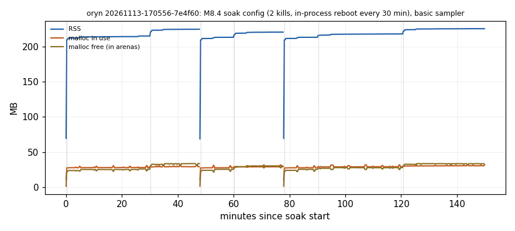
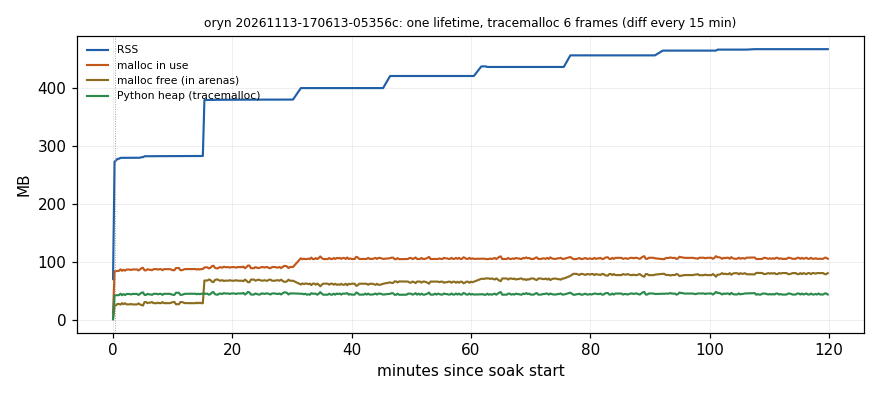

# Memory profile of the device process (M8.5)

**Question.** The M8.4 150-minute live digital-twin soak (oryn job
`20261113-091549-69607a`, TWIN-branch commit `4dba877`) reported the virtual
device process's RSS going 205.6 → 236.4 MB (max = last) and
`rss_slope_mb_per_h_final_lifetime_after_10min: 32.717` over its final ~72-min
lifetime (after two device kills); the backend stayed flat (−0.57 MB/h). Its
samples CSV had no per-sample RSS, so a warm-up plateau could not be told from
unbounded growth. Is the device leaking, and if so, what?

**Answer: no leak in the code under test.** On the current candidate code the
same soak reproduces the shape (final-lifetime linear fit 12.5 MB/h), and the
time series shows what it is: RSS is a **staircase**. It jumps 4–9 MB at each
*in-process runtime rebuild* (the soak's scheduled "SIMULATED reboot", which
rebuilds the whole `DeviceRuntime` inside the same process) and is flat between
them (0.5–3 MB/h for the first half hour, decaying). The Python heap
(tracemalloc), the live object count and glibc's *in-use* bytes stay flat; the
step is glibc keeping freed memory in its arenas (*free-in-arena* grows by the
step). Nothing of an old runtime survives a rebuild. A linear slope fitted over
a window that contains two of those steps reads as "33 MB/h". On a Pi a reboot
is a new process, so that staircase does not happen there; with no rebuilds a
single 2-hour lifetime stays flat (§3.3). No code fix was needed; regression
tests now pin the flat heap, the per-event caps and the rebuild release (§5).

Everything below is **SIMULATED** (the virtual device: real runtime, uplink,
dashboard and backend; scripted camera and models; no MediaPipe/Hailo inference,
see `docs/DIGITAL_TWIN.md` §1). It is not a Pi measurement: §7 is what the Pi
must measure on Sunday.

---

## 1. Method

### 1.1 Instrument (`scripts/sim/memory_profile.py`)

`MemorySampler`, a daemon thread **inside** the device process, appends one JSON
line per sample to `mem_samples.jsonl`:

| Field | Source | Why |
|---|---|---|
| `rss_mb` | psutil | what the soak reported |
| `rss_anon_mb`, `rss_file_mb` | `/proc/self/status` (Linux) | heap vs mapped files/libraries |
| `malloc.{inuse,free,arena,mmap}_mb` | glibc `mallinfo2()` via ctypes (Linux) | C heap in use vs **freed but kept in arenas** (fragmentation) vs mmapped |
| `py_heap_mb`, `py_heap_peak_mb` | `tracemalloc` (when on) | retained Python objects, numpy buffers included |
| `gc_count`, `gc_collections` | `gc` | collector activity |
| `gc_objects`, `types` (top 25) | `gc.get_objects()` census every 5 min | a growing type is a retained structure |
| `threads`, `threads_os`, `fds` | `threading`, psutil, `/proc/self/fd` | thread/socket leaks |
| `marks` | the harness | e.g. `runtime boot` at every (re)build |
| `cost_ms`, `census_ms`, `snapshot_ms` | itself | the profiler's own overhead |

With tracemalloc on, a baseline snapshot is taken after the warm-up and dumped to
a temp file (held in memory its trace tuples would be counted by every later
census); every `snapshot_s` the top allocation sites (file:line, and whole
tracebacks with >1 frame) are diffed against it into `mem_snapshots.jsonl`.

`analyze RUN_DIR` turns the series into, per process lifetime (pid): first /
at-warm-up / last / max and least-squares slopes (MB/h) before and after the
warm-up, in halves and over the last 30 min, for every series; the object-type
growth since warm-up; and **RSS segments** — a runtime boot or a tracemalloc
diff starts a segment, and each gets its step (settled level minus the previous
segment's end) and its *tread* slope once 5 min in, so a staircase is not read
as a ramp. It writes `memory_summary.json` and a PNG.

`watch` samples *another* process from `/proc` (stdlib only, read-only; a unit's
MainPID is re-read each sample) — the Pi tool (§7). `simclock` runs the device
alone on the SimClock with tracemalloc (hours of device time, deterministic,
no threads).

### 1.2 Soak switches (`scripts/sim/twin_soak.py live`)

`--mem-profile {off,basic,tracemalloc}` starts the sampler in the device process
(env `SDSOAK_MEMPROF`); the controller now also writes the per-sample process
series it used to drop (`samples_proc_live.csv`). One factor at a time:
`--viewers N` (concurrent `/stream` readers, 0 = none), `--no-stop-resume`,
`--quiet-timeline` (no events/faults), `--driver-attention-override JSON` (e.g.
`{"hands_policy": "always"}`), `--device-kills` / `--backend-restarts` (empty =
none), `--reboot-every-s` (in-process rebuilds; 0 = none), `--malloc-arena-max`
and `--device-env KEY=VALUE` (allocator experiments).

### 1.3 Overhead (measured)

| Mode | Cost |
|---|---|
| basic (no tracemalloc) | sample p50 0.5 ms; census 25–40 ms every 5 min; device CPU 11.1 % mean vs 12.5 % in M8.4 (job 7e4f60 vs 69607a): no visible cost |
| tracemalloc, 6 frames | device CPU 81.5 % mean (vs 11 %); each diff **50–63 s** holding the GIL (job 05356c, before the fix below); every diff steps RSS up (§3.2) |
| tracemalloc micro-benchmark, 600k traces | `take_snapshot` 0.13 s; `filter_traces` 4.5 s (1 frame) / 17.4 s (6 frames); `compare_to` 2.0 s / 7.5 s |

Consequences, applied: `filter_traces` is no longer used (the profiler drops its
own rows from the comparison instead), the baseline lives on disk, and the
rules are **RSS slopes are judged on basic runs only; allocation sites on
tracemalloc runs only, preferably with 1 frame**. macOS RSS is not usable for
slopes (memory compression moves it ±50 MB minute to minute, L1 below): Mac runs
are used for the Python heap only.

## 2. Runs

| Id | Where | Commit | Length | Config | Mode |
|---|---|---|---|---|---|
| **A** `20261113-170556-7e4f60` | oryn (WSL2, glibc 2.39, Py 3.12.16), 2 CPU / 1 GiB, no GPU | `2294171` | 150 min | exactly the M8.4 soak: 24 cycles, stop/resume each cycle, 2 device kills (0.3, 0.5), 2 backend restarts, in-process reboot every 30 min, 1 viewer | basic |
| **B** `20261113-170613-05356c` | oryn | `2294171` | 120 min | one lifetime: no kills, no restarts, no in-process reboots | tracemalloc 6 frames, diff every 15 min |
| **C** `20261113-190705-129c86` | oryn | `195f6af` | 150 min | one lifetime, as B | basic |
| **E** `20261113-193939-241751` | oryn | `195f6af` | 90 min | in-process reboot **every cycle** (6 min), no kills | basic |
| **F** `20261113-194027-19df16` | oryn | `195f6af` | 90 min | as E with `MALLOC_ARENA_MAX=2` | basic |
| L1 | Mac (M3, Py 3.12.12) | `2294171` | 25 min | one lifetime, 2 viewers | tracemalloc 6 frames |
| S0 | Mac | `2294171` | 1.4 sim-h | SimClock, device only | basic |
| S1 | Mac | `f95e9a1` | 2.9 sim-h (55 min wall) | SimClock, stop/resume each cycle | tracemalloc 1 frame, diff every 0.5 sim-h |
| P | Mac | `7627edb` | 6 restarts | SimClock, in-process restarts (`restart_probe`) | object census by class |

Small artifacts (summaries, JSONL series, PNGs, logs, manifests/state with the
exact commit and environment hash) are in
`~/sensordyme-audit/2026-11-10/m85-evidence/memory/`; fleet copies under
`~/sensordyme-fleet/runs/<id>/`. The oryn source differences between `2294171`
and `195f6af` are profiler-only (cheaper diffs, RSS anon/file fields).

## 3. Results

### 3.1 A — the M8.4 soak, reproduced on the candidate, with a time series

| | M8.4 (TWIN `4dba877`) | A (candidate) |
|---|---|---|
| device RSS first → last (controller) | 205.6 → 236.4 MB | 164.4 → 225.8 MB |
| final-lifetime linear slope after 10 min | 32.7 MB/h | 12.5 MB/h |
| device CPU mean | 12.5 % | 11.1 % |
| events lost / duplicated | 0 / 0 | 0 / 0 (216 events) |

Per lifetime (pid), the RSS segments:

| Lifetime | Segment start | Why | Settled step | Settled → end | Tread slope |
|---|---|---|---|---|---|
| 531 (0–48 min) | 15 s | first boot | (warm-up to 214.0) | 214.0 → 215.3 | 3.0 MB/h |
| | 1815 s | in-process reboot | **+9.3 MB** | 224.6 → 225.0 | 1.4 MB/h |
| 11562 (48–78 min) | 15 s | first boot | (to 213.4) | 213.4 → 213.5 | 0.5 MB/h |
| | 735 s | in-process reboot | **+6.9 MB** | 220.4 → 220.9 | 2.0 MB/h |
| 21222 (final, 78–150 min) | 15 s | first boot | (to 213.4) | 213.4 → 213.5 | 0.5 MB/h |
| | 735 s | in-process reboot | **+4.2 MB** | 217.7 → 218.3 | 1.2 MB/h |
| | 2535 s | in-process reboot | **+7.0 MB** | 225.3 → 225.8 | 1.2 MB/h |

Across the final lifetime the other series: live objects 108.9k → 112.4k
(±1.5k sample to sample; +3.5k over three runtime builds), glibc in use
27.6 → 31.3 MB, **glibc free-in-arena 25.3 → 32.5 MB**, arena total
52.9 → 63.7 MB, mmapped 2.4 MB flat, OS threads 24 → 23, fds 8. At each
rebuild the arena grows by about the RSS step and nearly all of it is *free*
memory glibc keeps (e.g. the 2535 s rebuild: arena +6.8 MB, in use +1.2 MB,
free +5.6 MB).

So the 72-min "slope" is two rebuild steps plus a settling tread, fitted with a
line. The M8.4 run had the same schedule (reboots at ~30-min marks inside its
final lifetime); its per-sample RSS was not recorded, so its larger figure
cannot be decomposed after the fact — it ran the TWIN branch, not this code.

### 3.2 B — one lifetime, tracemalloc: no retained Python objects

After the 15-min warm-up, over 105 min:

| Series | at warm-up → last | slope after warm-up | 2nd half |
|---|---|---|---|
| Python heap (tracemalloc) | 44.9 → 43.7 MB | −0.05 MB/h | +0.14 MB/h |
| live gc objects | 108.6k → 109.3k | (+682 in total) | |
| glibc in use | 87.6 → 105.3 MB | +7.3 MB/h | **+0.15 MB/h** |
| glibc free-in-arena | 28.7 → 80.6 MB | +11.6 MB/h | +10.3 MB/h |
| RSS | 282.7 → 467.2 MB | +61 MB/h | +37 MB/h (last 30 min +13) |
| OS threads / fds | 23 / 8 | 0 | 0 |

The RSS staircase here has a step at **every tracemalloc diff** (every 15 min)
and flat treads in between: summed over the seven treads, RSS moved **+1.5 MB in
~93 min**. The steps are the profiler (a diff allocated hundreds of thousands of
temporary objects for 50–63 s); the steps shrink (+97, +20, +20, +16, +20, +8,
+2, +1 MB). The top allocation sites at the last diff (6346 s) are all ≤ 1 MB
and churn, not growth: a frame buffer moved between `numpy/core/numeric.py:329`
/ `services/runtime.py:3127` / `modules/driver_attention.py:2141` (±900 KiB, 2–3
blocks = the frames in flight), and per-frame landmark/eye-signal objects that
are *fewer* than at the baseline (`modules/driver_attention.py:2325` −82 KiB,
`sim/perception.py:84` −82 KiB, `core/eye_signal.py:259`,
`core/behavior/engine.py:317/330`, `core/perception.py:824`).

L1 (Mac, 25 min, 2 viewers, tracemalloc): Python heap 44.8 → 44.2 MB after the
5-min warm-up (−0.05 MB/h); objects −277; threads 23, fds 12, flat.

### 3.3 C — one lifetime, basic: does RSS plateau?

*(filled from job 20261113-190705-129c86)*

### 3.4 SimClock (S0, S1): what grows, and where it stops

S1, 2.4 sim-hours after a 0.5-h warm-up with stop/resume every cycle: Python
heap 27.45 → 27.76 MB (**+0.10 MB per sim-hour**), objects +727. Every site that
grew is a **capped** per-event memory filling towards its cap, or the harness:

| Site | Growth per sim-hour | What | Cap |
|---|---|---|---|
| `core/alerts.py:575/567/898` | ~120 objects, ~25 KiB | `AlertDelivery` records (`AlertManager._deliveries`) | 256 (`_DELIVERY_MEMORY`) |
| `core/alerts.py:706` | stopped at 140 after ~1.5 h | ended episodes (`_recent`) | 100 (`_RECENT`) |
| `core/uplink.py:492/493`, `uuid.py:336`, `sim/faults.py:168` | 90 | event keys and timestamps held by the **harness** `EventLedger` | none (test harness only) |

At the caps the device's per-event memory is ≈ 256 deliveries × ~0.4 KiB +
128 uplink follow-ups: about 0.1 MB.

### 3.5 Rebuilds release the old runtime (P)

Six in-process restarts on the SimClock (`stack.restart`): exactly one live
`SimRuntime`, `DriverAttentionModule`, `SimUplink`, `AlertManager`,
`PerceptionEngine`, `FrameBus`, `HealthMonitor` and `VirtualDevice` after each;
live objects 147 049 after every restart; pymalloc blocks +35 per restart.

### 3.6 E, F — rebuild every cycle, default allocator vs `MALLOC_ARENA_MAX=2`

*(filled from jobs 20261113-193939-241751 and 20261113-194027-19df16)*

## 4. Verdict

<!-- VERDICT -->

## 5. Fixes and tests

No product code changed: no retained object was found to fix. Tests that would
catch one (all deterministic, SimClock):

- `tests/test_m85_memory_bounds.py`
  - `test_the_device_python_heap_is_flat_after_warmup`: busy minutes (drowsiness,
    phone, distraction, stop/resume through the backend) after a warm-up may not
    grow live objects by ≥ 1200 or pymalloc blocks by ≥ 2400 (measured: +45 /
    +282 over 3 busy minutes; one retained object per frame is +3600).
  - `test_the_heap_check_catches_one_object_retained_per_frame`: the same check
    with a leak injected on purpose fails the bound (it is not blind).
  - `test_a_restarted_runtime_releases_the_previous_one`: three in-process
    restarts leave one of each runtime component alive.
  - `test_alert_policy_memory_is_capped_however_many_alerts`,
    `test_uplink_alert_memory_is_capped_however_many_alerts`,
    `test_dashboard_history_is_capped`: driven 3× past their caps, the
    deliveries / ended episodes, uplink follow-ups / queued episodes / queue,
    and dashboard event history stay at their caps.
- `tests/test_m85_memory_profile.py`: the profiler's slopes, segments, census,
  site diff (finds a deliberately retained allocation at its line) and `/proc`
  reader.

## 6. Residual risk

<!-- RISK -->

## 7. Sunday: what the Pi must measure

<!-- PI -->
